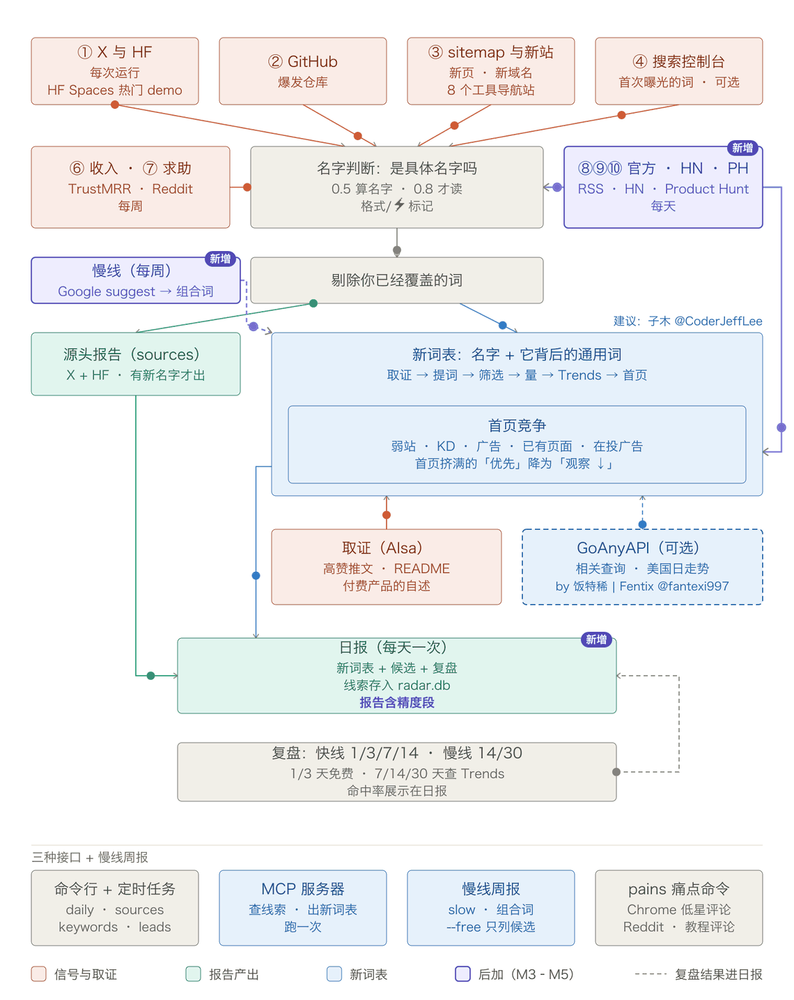

# keyword-radar（新词雷达）

> 本项目不是 [new-term-radar](https://github.com/zhuyansen/new-term-radar) 的 GitHub fork，而是基于它（MIT）重建的独立项目，聚焦海外 AI 新词的**发现**：不做建站、不做推送、不做页面生成。仓库名是 keyword-radar；Python 包、MCP 清单和 PyPI 身份仍沿用上游的 new-term-radar。

每天一份报告，列出 AI 领域里刚开始冒头的名字：新模型、新产品、新工具、新仓库。在它们最早被说出来的地方抓，而不是等关键词工具里有数据再看。

适合围绕新词做页面、写内容、做产品的人：AI 工具站的 SEO、Newsletter、导航站，或者任何想在「Strata」「Seedance」出现当天就知道、而不是两周后才知道的人。

## 为什么做这个

一个新名字会按这个顺序留下痕迹：

1. 实验室或大号在 X 上先说出来；模型进入 Hugging Face 热门榜。
2. GitHub 上某一个仓库自己涨起来。
3. 导航站和竞品给它加页面；有人为它注册域名，新站开始有排名。
4. 你自己的站第一次因为这个词有了搜索曝光。
5. Google Trends 上出现曲线，这已经是几天到几周之后了。

关键词工具读的是第 5 步。这个雷达每天读第 1 到 4 步，第 5 步只用来复盘自己准不准。

它最初就是照着一个例子做的：[Niko1221/Strata](https://github.com/Niko1221/Strata) 创建于 2026-09-24，九天后 7,700 星。9 月 26 日起就有人在搜「niko strata」，而当时没有第二个仓库用这个名字，关键词工具里也查不到。一个仓库每天涨 800 星，这本身就是全部信号，而且是公开的。

## 它读什么



图是上游 0.4 版的流程，紫色标「新增」的是 0.3/0.4 加的 ⑥ 收入、⑦ 求助、首页竞争、⚡ 和 `pains`。本项目后来加的 ⑧ 官方、⑨ HN、⑩ Product Hunt、慢线和多窗口复盘没有画进去（重画需要 `rsvg-convert` 和 `ffmpeg`，暂时没重画）；图里的 3 个 Agent Skill 和插件入口也已移除，现在 agent 接口只有 MCP。以文字和下表为准。

| 信号 | 抓什么 | 需要 | 花费 |
|---|---|---|---|
| ① X | 你关注的账号里，60 天内第一次出现的名字 | AIsa key | 每个账号每次 $0.003 |
| ① Hugging Face | 新进热门榜前 50 的模型和 Space（大家实际在试的 demo）；量化版、微调版和模型自己的 demo 归到同一个基础名下 | 无 | 免费 |
| ② GitHub 爆发 | 创建不到 14 天、平均每天涨 200 星以上，或比昨天多 400 星的仓库；附带大家实际会搜的写法（「niko strata」） | 无（有 GitHub token 限额更高） | 免费 |
| ③ 竞品 sitemap | 某个站新增的几个网址共用、而它的旧网址里很少出现的词。示例配置盯着 8 个 AI 工具导航站（toolify、aixploria、ai-bot.cn、opentools、dang.ai、clipfly、aitoptools、futurepedia）和 4 个 MCP、skill 目录 | 你列出的 sitemap | 免费 |
| ③ 新站 | 近 90 天注册且首次被收录、已经有 20 个以上排名词的域名 | AIsa key | 每个查询约 $0.13，每周一次 |
| ④ Search Console | 你的站第一次获得曝光的查询词（用新鲜数据） | 你自己的 Google 授权 | 免费 |
| ⑤ 复盘 | 快线 1/3/7/14 天、慢线 14/30 天；1/3 天本地免费，7/14/30 天查 Google Trends，和它自己的基线比；按信号统计命中率和提前天数 | AIsa key | 每个搜索写法 $0.0012 |
| ⑥ 收入 | 有人付钱的产品，来自 TrustMRR 核验过的收入：增长最快的（30 天收入 $500 以上）和最新上榜的；上次 $0、这次过了门槛的排最前。它自己的介绍会作为依据交给新词表 | TrustMRR key | 免费，6 次请求，每周一次 |
| ⑦ 求助 | Reddit 上大家在要什么（"is there an AI tool that…" 等 12 种问法）：模型留下 AI 工具能解决的求助和抱怨，把每件事写成大家会搜的说法；有搜索量的再做首页竞争检查 | AIsa key | 每周约 $0.12 |
| ⑧ 官方 | 六个实验室/机构的 RSS（OpenAI、Google AI、DeepMind、Hugging Face、Mistral、Microsoft Research）最近 7 天的发布；标题里取名字，发布词和动名词过滤 | 无 | 免费 |
| ⑨ Show HN | 最近 30 小时、30 分以上的 Show HN，最多 25 个名字；每个帖子只报一次 | 无 | 免费 |
| ⑩ Product Hunt | AI 主题最近 26 小时、50 票以上，按票数排序 | `PH_API_KEY`（开发者 token） | 免费 |
| 新词表 | 针对当天的新名字：找出它背后的通用搜索词（大家拿这个新东西做什么），逐个估算规模、看首页还有没有位置，并给出决策 | AIsa key；[GoAnyAPI](https://goanyapi.com) key 可选 | 5 个名字约每天 $0.18，加上 GoAnyAPI 约 $0.30 |
| 名字判断 | 小模型给每个词打分：是某个具体东西的名字，还是普通词？ | AIsa key | 每次不到一美分 |

价格是 2026 年 10 月 AIsa 的实际收费。按示例配置（35 个 X 账号，每天跑一次 `daily`，新词表读 5 个名字），单次约 **$0.34–0.40**（2026-10-18 实测 $0.395）；周跑一次慢线约 $0.19（首次 $0.349，调参后未复测）；月跑一次精度 $0.09；一个月合计约 **$12**。少读几个账号或减少名字，费用按比例下降。建议把日上限设在 $1。

### ⑥ 收入：大家已经在付钱的东西

一个能赚钱的产品，证明了它背后的需求。设置 `TRUSTMRR_API_KEY`（在 TrustMRR 的开发者后台生成）后，雷达每周读一次（`revenue.weekday`，默认周一）：近 30 天收入至少 `min_revenue_usd`（$500）、增长最快的 30 个产品，以及最新上榜的 30 个，并记下这次看到的。最新上榜的大多还几乎没收入，读它们是为了记下起点：上次 $0、这次过了门槛的产品会排在最前。隐藏的条目（"Anonymous startup"）不算；公司全称会换成网站名（"Talent Tech Global Limited" 读作 gptproto）。每个产品自己的介绍会作为依据交给新词表，于是新词表读出的是大家付钱买的那件事，而不只是品牌名。增长超过 1,000% 的显示为「从接近 $0 涨起来」：第一次运行时，增长最快的大多是从几乎为零起步的。

TrustMRR 的 API 条款禁止转载它的数据，也禁止拿它做公开的 SEO 页面。这些线索只供你自己研究，不要公开这份清单。

### ⑦ 求助：大家直接说出来的需求

雷达每周在 Reddit 上按十来种求工具的问法搜一次（"is there an AI tool"、"I wish there was a tool"、"how do I automate" 等，见 `asks.patterns`），留下最近一周、得分 2 以上的帖子，让一个小模型分类：求助、抱怨、分享的解法，或其他。对 AI 工具能解决的求助和抱怨，它把要做的事写成大家会搜的说法（"add b roll automatically"、"convert slides to notes"）。月搜索量 50 以上的列出来，附上帖子并做首页竞争检查，每件事记为一条线索。大多数求助太具体，还没有搜索量：第一次真实运行，一周 84 个帖子里有 43 个求助，只有两个月搜索量过 50（"best ai tool for research"，来自 r/PhD 一个 1,034 分的帖子；以及 "best ai tool for coding"）。所以其余得分最高的也会单独列出来，作为点子而不是关键词。试跑时读一个月的帖子，找到了「有没有 AI 工具能把 PPT 课件转成笔记」——正是一门工具站课程拿来做示范的那个需求。

帖子只供自己研究：可以引用，不要转载。

### ⚡ 教程观众在要什么

对每天最多 3 条带 ⚡ 的线索（一条被大量转发的手动流程教程），雷达找出它的热门教程视频（GoAnyAPI），读视频下的评论（AIsa，每页 $0.001），让模型挑出观众在要什么：哪一步太难、「能不能一键搞定」。这张清单就是那个一键工具。找视频需要 GoAnyAPI key。

## 两条线：快线 / 慢线

| | 快线 | 慢线 |
|---|---|---|
| 找什么 | 新出现的专名（模型、产品、仓库） | 组合词/通用词（`ai {品类} {动作}`） |
| 怎么发现 | ①–④、⑥–⑩ 的发现信号（⑤ 是复盘，不算发现） | Google suggest（免费），160 个种子 |
| 什么时候跑 | 每天 `daily` | 每周 `slow`（`--free` 跳过付费步骤） |
| 报告 | `report.md` / `report.json` | `slow.md` / `slow.json` |
| 复盘窗口 | 1/3/7/14 天 | 14/30 天 |
| 名字名额 | 有（每天读 5 个） | 没有，只进新词表 |

隔离是结构性的：慢词存在 `terms.window='slow'`，不进快线的名字名额（`select.SLOW`）、不被读（`usecases.READ_KINDS`）、不进快线复盘（`due()` 和 `summary()` 过滤）。如果一个慢词后来被快线信号命名，它的 `window` 翻成 `fast`，从那天起按快线复盘。

## 新词表

只有名字是不够的。「SynthID Detector」作为关键词寿命短，而且是 Google 的；它做的那件事「ai image detector」才是大家会一直搜的词，而且不属于任何人。雷达每天会把新名字再读一遍，把两种词写进同一张表：

```
| 关键词 | 类型 | 来自 | 新词? | 估算日搜 | 规模 | 开始上涨 | 现在 | 首页竞争 | 决策 |
|---|---|---|---|---|---|---|---|---|---|
| **solidcraft** | 名字 | — | 是 | 162 | 已知 | 2026-10-13 | 还在涨 (US) | 能进 · 3 个弱站 · KD 0 · 已有 312 个页面 · 3 家在投广告 | 观察 |
| **free llm api** | 通用词 | beam | 否 | 79 | 已知 | 2026-10-14 | 还在涨 (US) | 一般 · 0 个弱站 · KD 22 · 有广告 · 已有 71 个页面 | 观察 |
| **gpt 6.1 soul** | 名字 | — | 是 | 0 | 已知 | 2026-10-04 | 回落 | — | 跳过 |
```

（2026-10-18 一次真实运行的节选，省略了峰值、近 7 天比等列）

它是怎么做出来的（`radar/usecases.py`）：

1. **取证**：搜提到这个名字的高赞帖子（X 高级搜索）；如果是仓库，再读它的 README。
2. **提词**：模型读完证据，针对它看到的每一种用法，写出普通人会搜的关键词，并附上原话作依据。借别的产品名字的写法（「photoshop alternative」）会保留并标 ⚠：需求常常挂在老牌产品上，要不要用别人的品牌由你判断。
   如果配了 GoAnyAPI 的 key（可选，见下），雷达还会取这个名字在 **Google Trends 里的相关查询**：大家实际把什么词和它一起搜。SynthID Detector 拿到的是「ai photo detector」「google ai detector」「ai detector」，这些行带 🔎。包含名字本身的查询列为它的长尾（「photocraft download」「nano banana 2.1 vs pro」）。本身是别的新东西名字的查询（「nano banana 2.1」旁边的「gpt image 2.5」）单独记为线索。
3. **筛选**：再调一次模型，给每个写法打分：这个名字能不能回答这个搜索；同时标出品牌、认出别的东西的名字。关系不够直接的丢掉。Claude Haiku 5.5 提出的 6 个全被筛掉（「ai coding assistant」「github copilot alternative」）；SynthID Detector 的 5 个全部保留。
4. **搜索量**：一次批量查询，取剩下写法的 Google Ads 月搜索量。低于 `min_volume` 的丢掉，大部分都会被丢掉。
5. **Trends**，每行查两次：单独查这个词，得到曲线形状（是不是新词、哪天开始涨、峰值、近 7 天比前 7 天、现在的走势）；和基准篮子里的每个词放在一起查，得到规模。篮子默认六个（`chatgpt`、`ai image generator`、`ai video generator`、`text to speech`、`canva`、`pdf converter`），不通过月度检查的会被剔除并在表下写明。
6. **首页竞争**，只查会被采取行动的行（最多 8 行）：Google 第一页（每词约 $0.002）、第一页上每个站的评分（GoAnyAPI，每站 $0.002，保留 30 天）和关键词难度（每次 $0.012）。有 GoAnyAPI key 时，还会看谁已经在为这个词做东西、谁在为它付钱：近一个月标题里带这个词的页面数（「已有页面」）和在这个词上投谷歌广告的域名（「在投广告」，来自广告透明度），每行 $0.008。`能进` = 前十里有 3 个以上评分低于 30 的站，或难度低于 20；`挤满` = 一个弱站都没有、难度 40 以上；其余为 `一般`。表下面会列出首页最弱的那个站（新页面最容易挤进去的位置），以及首页由哪类页面构成（工具、榜单、文章、视频、论坛）。首页有广告，说明有人在花钱买这个点击。

日搜是估算值。通用词用它自己的 Google Ads 月搜索量，沿它自己的 Trends 曲线推到今天。再用这些词反推出基准篮子的规模，名字还没有搜索量数据，就对比篮子来估。

决策：**优先** = 近 30 天涨过、现在还在高位、估算日搜不低于 `min_daily`（规模未知时，≥2 个信号发现它且名字分 ≥0.8 也算）。**观察** = 涨了但规模小，或还太早读不出，或没动但本身有这个规模的稳定需求。**跳过** = 已回落，或没动且规模小。

首页 `挤满` 的 **优先** 会降成 **观察 ↓**：还在涨，但首页被强站占满。新名字第一周的首页还在成形（新闻、官方页），以三天后第二次读到的为准。

标记：🎬 视频、🎙 语音、🖼 图片 说明它产出什么，一般用户愿意付费的顺序是 视频 > 语音 > 图片 > 文字；同等条件的线索按这个排序。⚡ = 有 1,000 赞以上的帖子在手把手讲一套手动流程，或在跟一个热梗：还没人做成一键工具。两者都是按关键词规则从线索自己的字句和帖子里读出来的；在 6 个已知名字上（Nano Banana、Veo 3.1、Seedance 2.5、Claude Opus 5.5、ElevenLabs v4、Qwen Image 2.1）格式 6 个全对，⚡ 只触发一次，是一条被大量转发的 Opus 5.5 + Blender + Unreal 教程。按标记行动前先读原帖。

从我们最早跑的 8 个名字看，对它应该有这样的预期：

- **名字涨了；通用词在五天内大多没涨。** PhotoCraft、Claude Haiku 5.5、SynthID Detector 的搜索都明显上升。它们背后的通用词里有一个动了：PhotoCraft 出现后，「photoshop alternative」在美国连续五天比之前高出约 80%。这张表读的全球日数据几乎没反映出来（2、1、1、2、4、2），而另一个来源的美国日数据看得很清楚。所以全球数据显示「没动」，不能证明这个词真的没动。配了 GoAnyAPI 的 key 后，规模较大的行改读单个国家的数据，在那份数据里比之前高 50% 且持续三天算上涨；同一次运行里「photoshop alternative」就显示为 `还在涨 (US)`。
- 这张表今天靠得住的用处，是告诉你**一个新东西对应的是哪个已有需求、这个需求有多大**（「ai image detector」约每天 2,500 次搜索）。通用词会不会跟着名字涨，要等 7 天/14 天复盘才知道，我们现在还没有结果。
- 对纯模型发布（Claude Haiku 5.5、Nano Banana 2.1），证据都是公告和跑分，提出来的词很弱（「ai coding assistant」）。对只做一件事的产品和仓库效果更好。
- **Google Trends 最后两天的数据没有结算。** 互不相关的词在这两天会依次返回 0 和 100，看起来像一个尖峰。我们第一遍就是被这个骗了；现在代码里所有读 Trends 的地方都会丢掉这两天，而且上涨必须持续两天才算数。
- Google Ads 的搜索量滞后约两个月。月搜只有几百的词，Trends 基本读不出可靠的数。

### 某个数据源没配或挂了的时候

表照常产出，但会变薄，并且会写明缺了哪一块：

| 情况 | 表里少了什么 | 表下面会出现的一行 |
|---|---|---|
| 没配 `GOANYAPI_API_KEY`（默认就是这样） | 没有 🔎 行、没有名字的长尾、没有「一起被搜的其他名字」、没有 `(US)` 走势。通用词只来自模型，走势全部读全球数据，真实的上涨可能被读成「没动」 | 「相关查询未开启：设置 GOANYAPI_API_KEY 后…」 |
| GoAnyAPI 的 Trends 挂了（接入第一天 2026-10-12 就遇到过） | 这一次运行等同于没配 key | 「相关查询失败：…」和「国家数据获取失败，已退回全球数据：…」 |
| 某个名字的 AIsa 推文搜索失败（2026-10-13 遇到两次超时） | 这个名字的推文证据。仓库还有 README 可用；没有 README 的模型或产品就只剩相关查询，如果又没配 GoAnyAPI，这一天它就没有通用词 | 「推文搜索失败，这次只用了 README 和相关查询：…」 |
| 某个名字既没有推文也没有 README | 它的通用词；名字自己那一行还在 | 「没找到帖子或 README：…」 |
| 当天没有名字得分 0.8 以上的「东西」类线索 | 整张表 | 「今天没有要读的名字…」 |
| AIsa 的搜索量或 Trends 查询失败 | 整张表：这两项没有替代来源 | 表的位置直接显示报错 |

表变薄不等于今天没动静。下结论说「什么都没涨」之前，先看表下面这几行。

把配置写成 `"usecases": {"per_day": 0}`，或者加 `--skip usecases`，可以关掉它。

## 复盘：1/3/7/14 天和 14/30 天

| 线 | 窗口 | 怎么读 | 花费 |
|---|---|---|---|
| 快线 | 1 天、3 天 | 本地免费：`name_real` = 判断分 ≥ `review.name_real_score`（默认 0.80）；`persistence` = `last_seen > first_seen` | 免费 |
| 快线 | 7 天、14 天 | 最终检查时一次拉一条 Trends 序列，按 `first_seen + 天数` 切出两个窗口 | 每个搜索写法 $0.0012 |
| 慢线 | 14 天、30 天 | 同上，一条序列切两段 | 同上 |

- 每线每天最多 5 条（`review.per_day`）。这是抽样：新线索约 20 条/天，`due` 会增长；报告会打印每线待查和到期数（2026-10-18：快线待查 58、慢线 24）。
- 7 天/14 天的行在最终检查时一起产生，不会提前 7 天查；还没满 14 天的词要等下一次检查。
- 一批 Trends 失败只影响那一条线，词留在待查里，错误写进报告的 ⑤ 和 `runs.errors`；一个词缺一个变体答案时也留在待查里。
- `name_real` 读的是检查时的判断分，`record()` 之后还能重新打分；它回答的是「检查时它还是不是个名字」，不是「第一天是不是」。
- 第一批付费行：快线 **2026-10-29**、慢线 **2026-11-14**。在那之前报告写「Trends 没有到期（第一个检查在 2026-10-29）」。

### 精度抽样（sitemap / 新站的 echo 词）

`python -m radar precision --n 10` 抽 10 个只有 sitemap/新站信号、还没抽过的 `status='echo'` 词，一次 Google Ads 批量查它们的月搜，标成 `new`（低于阈值）/ `searched`（≥ `review.sampling.existing_volume`，默认 1000/月）/ `unknown`（没查到量）。2026-10-18 首跑：10 个样本，7 new / 3 searched（aws 368k、bitbucket 33.1k、engram 12.1k），0 unknown，花费 **$0.090**。报告和 `leads` 汇总最近 90 天。

## 痛点：`python -m radar pains "ai headshot"`

把大家对一类工具的抱怨，归纳成新工具能填的缺口：

- Google 上这个词对应的 Chrome 扩展的低星评论（1 到 3 星），或你用 `--extension ID` 指定的扩展（GoAnyAPI：找扩展 2 credits，每页评论 3 credits）；
- Reddit 上抱怨这件事或相关工具的帖子（"{关键词} alternative"、"{关键词} frustrating" 等；AIsa）；
- 这个词的热门教程视频下的评论（AIsa）。

模型把它们归成缺口（缺功能、太难、质量、价格、想要工具），每个缺口给出次数、例子和有这个问题的人会搜的说法。每个词约 $0.05。次数是读到的条目数，不代表市场规模。

读不到的：App Store、Google Play、Trustpilot 的评论（DataForSEO 是「先提交、后取结果」的任务接口，AIsa 只支持同步调用）；There's An AI For That 的求助板（每个页面前都有 Cloudflare 挑战，硬闯就是绕过对方的反爬，雷达不做）；Facebook 小组（Meta 2024 年 4 月关闭了 Groups API，它的研究数据库只对获批的学术和非营利研究者开放）。

## 一个必需的 key，一个可选的

所有付费的部分都走 [AIsa](https://go.aisa.one/yansen-zhu)：X 帖子、Google Trends 和域名数据（背后是 DataForSEO）、判断名字的模型。一个 key，按次付费，不用分别订阅 X API 和 DataForSEO。

> 上面是推荐链接：通过它注册是对这个项目的支持。从 aisa.one 任何入口拿到的 key 用起来完全一样。

**可选：`GOANYAPI_API_KEY`**（[goanyapi.com](https://goanyapi.com/r/ga-95708898fb)）从两方面改进新词表，每天约 $0.07：给每个名字加上 Google Trends 的相关查询；名字和规模较大的通用词（月搜 1,000 以上，最多 8 行）的走势，改用单个国家的 30 天日数据来读，这份数据结算到昨天。这些行的「现在」一列后面会标出国家，例如 `还在涨 (US)`。不配这个 key，新词表只用模型提出的写法和全球数据。这个服务很新（2026 年 8 月才发布）；我们测试时每次调用要 20 到 55 秒，大约十次有一次失败，所以雷达会试两次，失败就写在表里，继续往下跑。上面这个也是推荐链接。

`PH_API_KEY` 是 Product Hunt 开发者后台的 token（公开读，免费），不配就没有 ⑩。`TRUSTMRR_API_KEY` 不配就没有 ⑥。没有 AIsa 的 key 时，免费的信号照常运行（Hugging Face、GitHub、sitemap、Search Console、HN、官方 RSS），只是报告里所有词不分先后列出，因为没有模型判断哪些是名字。

## 快速开始

需要 Python 3.10 或更高版本。雷达本身只用标准库。

```bash
git clone https://github.com/pang3fan-creator/keyword-radar
cd keyword-radar
cp config.example.json config.json      # 然后编辑：你的 X 账号、sitemap、主题；想要中文报告把 lang 改成 "zh"
cp .env.example .env                    # 填 AISA_API_KEY（可选 GOANYAPI_API_KEY、PH_API_KEY）
python -m radar daily --out report.md
```

也可以直接 `export AISA_API_KEY=...`，`.env` 里的同名值会覆盖 shell 变量。

第一次运行只是建立快照：昨天的 X 词表、星数、sitemap 网址都还没有，所以只会报出 GitHub 爆发仓库（它不依赖昨天的数据）。从第二次运行起，每个信号都会报告变化。

### 命令

| 命令 | 做什么 | 花费 |
|---|---|---|
| `daily --out report.md` | 全部信号 + 新词表 + 复盘，每天一次 | 约 $0.34–0.40 |
| `sources --out sources.md` | 只跑 ① X 和 HF，几小时一次 | $0.003 × 账号数 |
| `slow --out slow.md` | 慢线组合词，每周一次（`--free` 只列候选） | 约 $0.19（首次 $0.349） |
| `precision --n 10` | 名字精度抽样，每月一次 | 约 $0.09 |
| `leads --days 7` | 看库里的线索和复盘 | 免费 |
| `keywords "名字"` | 按需出新词表 | 每个名字约 $0.05，每次调用另加 $0.09 |
| `pains "ai headshot"` | 痛点 | 每个词约 $0.05 |

`daily` 带 `--skip x,hf` 时，会列出 `sources` 在过去 24 小时记下的线索。如果你每天只跑一次，直接用 `daily`，什么都不跳过。`sources` 只在有新名字时才写报告。

其他参数：`--skip` 可选 `x,hf,breakout,sitemaps,newsites,revenue,asks,gsc,review,judge,usecases,tutorials,hn,official,ph`；`--new-sites` / `--revenue` / `--asks` 让周信号今天就跑；`--free`（slow）跳过所有付费步骤；`--n`（precision）指定样本数；`--json`、`--days`（leads）、`--mail`、`--state DIR`。

## 报告长什么样

2026-10-18 一次真实运行的节选（中文报告，`"lang": "zh"`）：

```
### 候选新词(名额按信号轮发;已覆盖的会标出)

| 词 | 信号 | 名字得分 | 已覆盖 | 搜索变体 | 例子 |
|---|---|---|---|---|---|
| **beam** | huggingface:发布公告 | 0.90 | 无 | — | Welcome Beam: a 501B open model you can own, custo |
| **solidcraft** | GitHub 爆发 tangency-labs/solidcraft ★4348(均 422/天,一天 +732) | 0.95 | 无 | tangency-labs solidcraft, tangency solidcraft | tangency-labs/solidcraft: SolidCraft: an open-sour |
| **esp32sim** | HN 125 分,13 条评论 | 0.90 | 无 | — | Show HN: Esp32sim – Run ESP32 firmware in the brow |
| **nitrostack** | Product Hunt 275 票 | 0.90 | 无 | — | Build, test, and deploy MCP servers in one place |

### ⑤ 复盘(1 天、3 天免费;快线 7 天、14 天;慢线 14 天、30 天;后两者查 Google Trends)

今天已查:1 天 44, 3 天 13(免费);Trends 没有到期(第一个检查在 2026-10-29)。

| 信号 | 1 天名字 | 1 天强名字 | 3 天名字 | 3 天又出现 |
|---|---|---|---|---|
| ⑧ 官方 | 2 | 2/2 | 0 | — |
| ① X | 25 | 15/25 | 0 | — |
| ① HF | 2 | 2/2 | 0 | — |
| ② 爆发 | 18 | 14/18 | 13 | 0/13 |
```

`daily` 还会在 Markdown 旁边写一份 `report.json`，包含生成报告用到的全部数据。

## config.json

| 字段 | 含义 |
|---|---|
| `lang` | `"en"` 或 `"zh"`：报告的语言 |
| `x_accounts` | `labs` 和 `bloggers`：要读的 X 账号。实验室最先说出名字；博主选你这个领域里新词靠谁传开 |
| `sitemaps` | 想看哪些站新增了什么页面。`index` 是一个 sitemap；如果它是 sitemap 索引，用 `shards`（正则）挑要读的子 sitemap。`pause` 是对这个站两次请求之间的秒数。`strip_locale` 去掉 `/en/`、`/zh-CN/` 这类前缀，同一条目的多语言版本只算一次 |
| `topics` | 名称和正则：每个主题单独一节，列出匹配的线索、仓库和查询 |
| `known_terms` | 你已经有页面的词，或者永远不想看到的词。包含它或被它包含的线索会被标出，不进入复盘 |
| `stop_words` | 你这个领域的日常用词，追加到内置列表（内置列表是按 AI 工具领域调的） |
| `judge` | `model`（AIsa 上任意对话模型）和 `min_score`（默认 0.5） |
| `breakout` | `window_days`、`min_stars`、`velocity_min`（每天涨星）、`delta_min`（比昨天多的星） |
| `hn` | `min_points`（30）、`top`（25）、`lookback_hours`（30） |
| `ph` | `min_votes`（50）、`top`（25）、`lookback_hours`（26）、`topic` |
| `official` | `feeds`（六个 RSS）、`max_per_run`（10）、`lookback_days`（7） |
| `slow` | 慢线的种子和上限：`objects`、`actions`、`template`、`max_queries`（160）、`max_volumes`（120）、`trends_max`（25）、`page_one`（5）、`max_rows`（30）、`per_category`（8） |
| `new_sites` | `queries`：名称和域名的 SQL LIKE 模式（`"%ai%"`），每个是一次付费查询；`weekday`（0 = 周一）；`window_days`（90）、`min_etv`（1000）、`min_keywords`（20） |
| `review` | `windows.fast`（[1,3,7,14]）、`windows.slow`（[14,30]）、`per_day`（每线每天 5 条）、`name_real_score`（0.8）、`sampling`（`per_run` 10、`existing_volume` 1000） |
| `usecases` | 新词表。`per_day`（每天读几个名字，0 = 关闭）、`model`、`benchmarks`（比规模用的基准篮子）、`min_volume`（写法至少要有的月搜索量）、`min_daily`（判为「优先」所需的日搜）、`recheck_days`（3）、`related`（设了 `GOANYAPI_API_KEY` 时是否用相关查询）、`related_geo`（`US`）、`country_trends`（规模较大的行改读该国数据）、`country_min_volume`（1000）、`country_max`（8） |
| `gsc` | `site`（`sc-domain:example.com`）和 `token_file`。留 `{}` 即关闭 |

`revenue`、`asks`、`tutorials`、`pains`、`competition` 的键见 `config.example.json` 和 `radar/config.py` 的 `DEFAULTS`。

添加某个站的 sitemap 之前，请先看它的 robots.txt，`pause` 不要低于它的 crawl-delay。示例配置每天总共几十次请求，按 `pause` 间隔发出。

### Search Console（可选）

```bash
pip install google-auth-oauthlib
python scripts/gsc_auth.py gsc_client.json   # 打开一次浏览器授权，写出 gsc_token.json
```

`gsc_client.json` 是 Google Cloud Console 里类型为「桌面应用」的 OAuth 客户端，所在项目要启用 Search Console API。然后设置 `"gsc": {"site": "sc-domain:你的域名"}`。授权是只读的，凭证只留在你自己的机器上，`.gitignore` 已经把它排除了。

### 邮件（可选）

`--mail` 通过 [Resend](https://resend.com) 发送报告。设置 `RESEND_API_KEY`、`EMAIL_FROM`（你在 Resend 验证过的域名下的地址）和 `RADAR_EMAIL_TO`（多个用逗号分隔）。要 HTML 版需要 `pip install markdown`。

## 在 agent 里用：MCP 服务器

仓库不再附带 Agent Skill 或 Claude Code 插件（2026-10-18 移除：三套接口各自漂，MCP 一套就够）。下面是 MCP 服务器的配置。

给支持 MCP 的客户端用（Claude Code、Cursor、Claude Desktop）：

```bash
pip install "new-term-radar[mcp] @ git+https://github.com/pang3fan-creator/keyword-radar"
```

```json
{
  "mcpServers": {
    "new-term-radar": {
      "command": "new-term-radar-mcp",
      "env": {
        "AISA_API_KEY": "...",
        "RADAR_CONFIG": "/绝对路径/config.json",
        "RADAR_STATE": "/绝对路径/state"
      }
    }
  }
}
```

| 工具 | 返回什么 | 花费和耗时 |
|---|---|---|
| `recent_leads` | 雷达记下的线索，带复盘结论和各信号命中率 | 免费，立刻返回 |
| `keyword_table` | 你给的名字的新词表 | 每个名字约 $0.05，每次调用另加 $0.09；每个名字 40 到 90 秒 |
| `run_radar` | 跑一次 `sources` 或 `daily`，返回报告 | 付费，要几分钟。只适合第一次试用，定时运行应该交给 cron 或 Actions |

把 `RADAR_STATE` 指向定时任务写入的那个目录，`recent_leads` 看到的就是定时任务记下的线索。同样的两个功能在命令行里也有：`python -m radar keywords "名字" …` 和 `python -m radar leads`。

## 在 GitHub Actions 上跑

`.github/workflows/radar.yml` 每 8 小时跑一次 `sources`、每天跑一次 `daily`，状态存在 Actions 缓存里，报告写到每次运行的摘要页。默认关闭，需要你主动开启：

1. 把这个仓库放进你的 GitHub 账号（私有 fork 也可以）。
2. 把 `config.json` 从 `.gitignore` 里删掉，提交你的配置。配置里没有任何密钥。
3. 添加 secret `AISA_API_KEY`；可选 `GOANYAPI_API_KEY`、`PH_API_KEY`、`RESEND_API_KEY`、`EMAIL_FROM`、`RADAR_EMAIL_TO`、`GSC_TOKEN_JSON`。
4. 把仓库变量 `RADAR_ENABLED` 设为 `true`。

缓存是按运行恢复的：缓存没命中时，第二天只是重新建快照、报告为空；线索库会从头开始，所以在意复盘历史的话，定期把 `radar-state` artifact 下载下来。

## 各部分怎么判断

- **帖子里的名字**（`radar/terms.py`）：首字母大写的词、带数字的词（`Qwen3.8`）、中间有大写的词（`HyperFrames`）；名字后面的数字会并进去（`Opus 5.5`）。两个账号都用过的名字算数；只有一个账号用的，需要 100 个赞，而且必须明显是名字，因为首字母大写的词常常只是句子开头。
- **官方 / HN / PH 的名字**（`radar/official.py`、`hn.py`、`ph.py`）：标题开头 1–3 个词，去掉发布词和动名词；只有一个 maker 名、没有版本号的（`openai`）不算；每个帖子/产品只报一次，低于门槛的以后再涨上来仍算新。
- **sitemap 里的上升词**：按不同网址计数，并和这个站自己的基线比，所以一个长网址造不出一波假信号。
- **名字判断**（`radar/judge.py`）：每 25 个词一次模型调用，每个词附带最多三处出现的原文。调用失败时报告照常发出，只是不排序。
- **复盘**（`radar/review.py`）：一个搜索写法在我们报出之后的峰值，超过它自己之前基线的 2 倍且高出 10 点，才算「涨了」。有旧含义的词（「strata」：岩层、分契式产权）基线本来就高，不算；「niko1221 strata」从 0 涨起来才算。Trends 没结算的最后两天不计入。

## 实测过什么，没测过什么

- 名字判断（`gpt-4.1-mini`）：拿我们自己日常使用中、之前的判断器放行的 170 个词重新判了一遍，它同意其中 149 个。它拒掉的 21 个里，大部分是之前误放的噪音（sitemap 路径碎片如 `io.github.wxt invoice`、`asd`），真正漏掉的名字大约 3 个（`synthid detector`、`veo`、`v4.1 flash`），而且这次测试给它的上下文比实际运行时少。40 个普通词（`dashboard`、`pricing`、`today`）没有一个被放行。
- 各信号的命中率：快线的 1 天/3 天窗口已经在跑（2026-10-18：44 条 1 天、13 条 3 天；1 天里 30 个名字通过强名字线，14 个没有），7 天/14 天要等 **2026-10-29**，慢线 14/30 天等 **2026-11-14**。唯一一条手工放进去的检查是 Strata，结论是命中，比 Trends 曲线起来早 3 天。
- 2026-10-18 的完整一天：`daily` **$0.395**（`runs` #5，无错误），20 条新线索，57 条免费复盘；`precision --n 10` **$0.090**，7 个新名字 / 3 个已经被搜过（aws 368k、bitbucket 33.1k、engram 12.1k），0 个查不到量。
- X 信号的好坏取决于账号名单。你的账号都没提到的名字，它看不到。

## 已知问题 / 还没验证

- **第一批付费复盘还没到**：快线 7/14 天在 2026-10-29，慢线 14/30 天在 2026-11-14；在那之前 `reviews` 里只有 1/3 天的免费行。
- **`name_real` 是判断器分数**（≥0.8），不是人工标注；**`precision` 是月搜阈值**（≥1000/月算「已经被搜过」），不是「这个产品是否已存在」的判定。50 个名字的人工抽检还没做。
- **复盘是抽样**：每线每天 5 条，新线索约 20 条/天，`due` 会增长；2026-10-18 快线待查 58、慢线 24。
- **7/14 天行在最终检查时一起产生**，不会提前 7 天查；14 天内没再出现的词不会被查。
- **慢线 30 天窗口**用的是一条 61 天的 Trends 序列，端点是否返回这个跨度要到 2026-11-14 才知道；当前 24 个慢词大多是迁移来的通用词，不代表 M4 的组合词。
- **没有调度器**：`daily` / `slow` / `precision` 都手动跑；`.github/workflows/radar.yml` 是参考，默认关闭。
- **benchmark 手动刷新**（`scripts/bench_check.py --apply`）；SQLite 的 `keywords` 表还没有写入；新词表的 `新词?` 列仍读 Trends 基线，不是 `first_seen`。
- **图是上游版**，没有画 ⑧⑨⑩、慢线和多窗口复盘；重画需要 `rsvg-convert`/`ffmpeg`，暂时没重画。
- 内置停用词和 Hugging Face 名字清洗是按 AI 模型和 agent 工具领域调的。换领域请加 `stop_words`。
- 日搜是估算：Google Ads 月搜滞后约两个月，月搜几百的词读不准；首页竞争只查会被采取行动的行（最多 8 行）。

## 文档

- [AGENTS.md](AGENTS.md)：协作契约——布局、命令、测试、成本、交接清单、当前状态。
- [docs/README.md](docs/README.md)：文档索引（现行 / 历史）。
- [docs/Roadmap/](docs/Roadmap/)：00 约束、01–04 路线调研、05 方法论、06 范围与垂直扩展。
- [docs/里程碑.md](docs/里程碑.md)：M0–M5 的开发记录（数字、提交、当时留下的问题）。

## 开发

```bash
pip install pytest markdown
python -m pytest -q tests
```

测试覆盖逻辑部分（名字提取、打分、存储、报告），不访问网络。跑单个文件更快：`python -m pytest tests/test_store_next.py -q`。

## 致谢

- [子木 @CoderJeffLee](https://x.com/CoderJeffLee)：新词表的想法来自他的建议，新名字和它下游的通用词应该放在同一张表里，每行给出决策。
- [饭特稀 | Fentix @fantexi997](https://x.com/fantexi997)：[GoAnyAPI](https://goanyapi.com)，相关查询和单个国家 Trends 走势这个可选数据源。
- [Jason Zhu](https://github.com/zhuyansen)：上游 [new-term-radar](https://github.com/zhuyansen/new-term-radar)，本项目的起点。

流程图由 `docs/make_diagram/make_diagram.py` 生成（需要 `rsvg-convert` 和 `ffmpeg`）。

## 许可

MIT。这套雷达提取自 [agentskillshub.top](https://agentskillshub.top) 背后每天在跑的版本；本项目的改动见 [docs/里程碑.md](docs/里程碑.md)。

<!-- mcp-name: io.github.zhuyansen/new-term-radar -->
